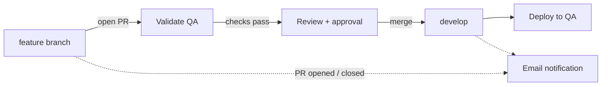

# Salesforce CI/CD Pipeline (GitHub Actions + Salesforce CLI)

A source-driven release pipeline for Salesforce, built with GitHub Actions and the Salesforce CLI. Every change is validated when a pull request is opened and deployed automatically when it is merged, with email notifications at each step.

> **Note:** This is a personal project built on a personal Salesforce Developer Edition org with sample metadata. It contains no employer or client code or data.

> **Before publishing:** search this file for `[CONFIRM]` and replace each one with what your workflows actually do. Delete this note when done.

---

## What it does

| Stage | Trigger | Workflow | What happens |
|-------|---------|----------|--------------|
| Validate | PR opened or updated | `validate-qa.yml` | Authenticates headlessly, runs a validation-only deploy to QA, runs Apex tests and code scan. Failure blocks the merge. |
| Deploy | Merge (push) to `develop` | `deploy-qa.yml` | Deploys the merged source to the QA org. |
| Notify | PR opened or closed | `pr-notifications.yml` | Sends an email summarizing the PR and its outcome. |

## Flow



## Branching model

- `feature/*` : short-lived branches for each change (one story per branch)
- `develop` : integration branch. Merging here deploys to QA.
- `main` : [CONFIRM: production-ready code / template default]

All changes reach `develop` through a pull request. [CONFIRM: branch protection requires passing checks and at least one approval.]

## Pipeline details

### Authentication
- Headless org login using [CONFIRM: JWT bearer flow with a connected app / SFDX auth URL]
- Credentials live in GitHub Actions secrets and are never committed to the repo.

### Validation (on pull request)
- Validation-only deploy (`sf project deploy validate`) to the QA org
- Apex tests: [CONFIRM: test level, e.g. RunLocalTests] with a minimum coverage of [CONFIRM: e.g. 75%]
- Static code analysis: [CONFIRM: tool, e.g. Salesforce Code Analyzer / PMD], failing on [CONFIRM: severity]
- LWC unit tests (Jest) and linting (ESLint): [CONFIRM: whether these run in CI]

### Deployment (on merge)
- Deploys changes from `develop` to the QA org
- [CONFIRM: full deploy vs. delta deploy of changed metadata only]

### Notifications
- Email on PR open and close (merge or reject), sent from the workflow using [CONFIRM: SMTP action / provider]

## Required secrets

Configure these under **Settings > Secrets and variables > Actions**:

| Secret | Purpose |
|--------|---------|
| `[CONFIRM: SF_CONSUMER_KEY]` | Connected app consumer key |
| `[CONFIRM: SF_PRIVATE_KEY]` | JWT signing key |
| `[CONFIRM: SF_USERNAME]` | Integration user for the QA org |
| `[CONFIRM: SF_INSTANCE_URL]` | Org login URL |
| `[CONFIRM: MAIL_USERNAME / MAIL_PASSWORD]` | Email notification account |

## Repository layout

```
.github/workflows/   CI/CD workflows
force-app/           Salesforce source (metadata)
manifest/            package.xml manifests
scripts/             Helper scripts
config/              Project and scratch org settings
.forceignore         Metadata excluded from deploy/retrieve
sfdx-project.json    Project configuration
```

## Local development

1. Install the [Salesforce CLI](https://developer.salesforce.com/tools/salesforcecli) and VS Code with the Salesforce Extension Pack.
2. Clone the repo and install dependencies: `npm install`
3. Authorize your own org: `sf org login web --alias dev`
4. Create a branch from `develop`: `git checkout -b feature/my-change`
5. Make changes, run tests locally, and push the branch.
6. Open a PR into `develop`. The validate workflow runs automatically.

Useful commands:

```bash
sf project deploy validate --source-dir force-app --test-level RunLocalTests --target-org dev
sf apex run test --test-level RunLocalTests --target-org dev --result-format human
npm run lint
npm run test:unit
```

## Troubleshooting

| Symptom | Likely cause | Fix |
|---------|--------------|-----|
| Validate fails at login | Expired or wrong secret, connected app policy | Re-check secrets and connected app pre-authorization |
| Validation fails on missing dependency | Component deployed without its dependency | Include the dependency in the PR or manifest |
| Coverage below threshold | New Apex without tests | Add tests; check the failing class in the run log |
| Code scan blocks the PR | Rule violation at or above the failing severity | Fix the violation or discuss a documented exception |
| Deploy succeeds but behavior differs | Profile or permission set drift between orgs | Compare permissions and update source |

## Roadmap

- [ ] Promotion path beyond QA (Stage) with manual approval gates (GitHub Environments)
- [ ] Reusable workflows shared across environments
- [ ] Post-deploy Playwright smoke test
- [ ] Jira key enforcement in branch or PR title
- [ ] Deployment metrics (duration, success rate)

## License

MIT (or update to your preference)
